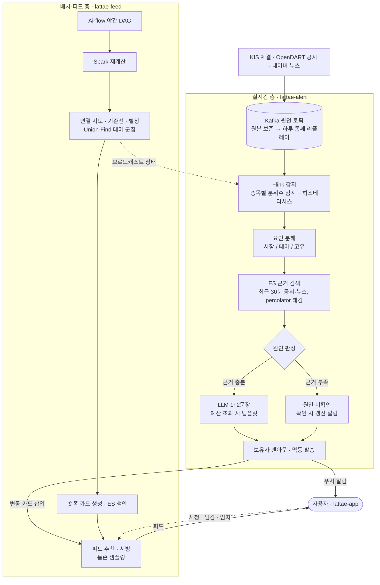

<h1 align="center">라때 (Lattae)</h1>

<p align="center">
  <b>보유 종목이 급하게 움직이면 60초 안에 "왜"를 근거와 함께 보내고, 그 이유를 이해할 숏폼으로 이어 주는 포트폴리오 정보 서비스</b>
</p>

<p align="center">
  
  
  
  
  <br/>
  
  
  
  
  
</p>

---

사용자는 보유 종목과 비중만 입력합니다. 서버는 장중 체결·공시·뉴스를 계속 받아 보유 종목이 평소와 다르게 움직이는 순간을 잡고, 그 움직임이 시장 때문인지·테마 때문인지·종목 고유 사건 때문인지 가려 근거 링크와 함께 알림을 보냅니다. 알림을 누르면 그 원인을 설명하는 숏폼 피드로 이어집니다.

```
보유 종목 · 비중 입력 (계좌 연동 없음)
→ 체결 · 공시 · 뉴스를 Kafka로 수집
→ 종목별 평소 변동폭을 넘으면 급변으로 감지
→ 시장 / 테마 / 고유 요인으로 분해한 뒤에만 근거 검색
→ 근거가 약하면 "원인 미확인"으로 먼저 보내고, 확인되면 갱신
→ 알림 한 줄에서 관련 숏폼으로, 시청 반응은 다시 추천으로
```

> 설계 단계 문서입니다. 아래 수치는 측정값이 아니라 목표치이며, 실측 후 갱신합니다.

## 핵심 문제 해결

### 알림 정시성 — 60초를 단계별 예산으로 나누고, 넘치면 강등

개장 직후나 변동성완화장치 발동 때는 수백 종목이 한꺼번에 움직이고, LLM 문장 생성은 수 초씩 흔들립니다. 감지와 생성을 한 줄로 묶으면 느린 생성이 감지까지 막습니다. 수집 2초, 감지 5초, 근거 검색 1초, 생성 15초로 예산을 나누고, 단계 사이는 Kafka 토픽으로 끊어 속도 차이를 흡수합니다. 생성 대기열이 예산을 넘으면 템플릿 문장으로 먼저 보내고 나중에 다듬습니다. 알림마다 멱등 키를 둬 재시도해도 한 번만 받습니다.

### 원인 정직성 — 지어내지 않고, 공개 라벨로 채점

급등락의 상당수는 뚜렷한 원인이 없습니다. 거래소 조회공시 답변에도 "특별한 사유 없음"이 많습니다. 그래서 먼저 시장 민감도(β)로 시장 몫을 빼고, 같은 테마 종목의 동반 움직임을 본 뒤에만 종목 고유 근거를 찾습니다. 문장은 검색된 공시·뉴스 안에서만 쓰고 원문 링크를 답니다. 관련도가 기준에 못 미치면 기권합니다. 정확도는 조회공시 답변, 공시 선행 여부, 팀 골드셋으로 만든 정답 라벨에 대해 VE60(60초 안에 도착한 정답 설명 비율)으로 채점합니다.

### 사용자 없는 개인화 — 공개 데이터로 추천의 뼈대를 계산

학생 프로젝트는 시청 기록이 거의 없어 협업 필터링이 동작하지 않습니다. 대신 공개 시세·공시로 매일 밤 종목 연결 지도를 계산합니다. 수익률 상관이 높은 종목쌍을 Union-Find로 묶어 테마 군집을 만들고, 별칭 사전(삼전 = 삼성전자)을 갱신합니다. 피드는 보유 종목에서 이웃 종목으로 후보를 넓히고, 카드 유형별 톰슨 샘플링으로 적은 반응에서도 선호를 학습합니다. 같은 지도가 실시간 감지의 테마 판정 기준으로도 쓰입니다.

## 아키텍처



| 층 | 하는 일 | 지키려는 것 |
|---|---|---|
| 수집 | 원천별 어댑터, 종목코드 키, 호출 한도 스케줄링 | 버스트와 느린 소비자가 서로를 막지 않음 |
| 감지 | 이벤트 시간 기준 분위수 임계, 시장·테마·고유 분해 | 같은 급변에 늦거나 두 번 반응하지 않음 |
| 설명 | 근거 검색 → 원인 분류 → 기권 또는 생성 | 근거 없는 이유를 지어내지 않음 |
| 발송 | 보유자 팬아웃, 멱등 키, 갱신 알림 | 60초 안에, 한 번만 도착 |
| 배치 | 연결 지도, 기준선, 별칭, 숏폼 카드 | 실시간 판단의 기준이 낡지 않음 |
| 피드 | 포트폴리오 기반 후보, 밴딧 순위 | 사용자가 적어도 개인화가 동작 |

## 레포지토리

| 레포 | 역할 |
|---|---|
| `lattae-alert` | 실시간 감지·원인 설명·알림 발송 |
| `lattae-feed` | 배치 파이프라인·연결 지도·피드 추천 |
| `lattae-api` | 인증, 포트폴리오, 푸시 구독, 두 서비스 응답 조합 |
| `lattae-app` | Vue PWA — HOME(내 포트폴리오) · REELS(숏폼 피드) |

## 데이터와 경계

모든 원천은 공식 Open API와 공공데이터, 사용자 직접 입력입니다. 뉴스 본문과 커뮤니티는 수집하지 않고 제목·요약·원문 링크만 씁니다. 실시간 시세는 급변 감지에만 쓰고, 화면의 가격과 차트는 공공데이터의 일별 시세로 그립니다. 종목 추천·매수 신호·목표가를 내지 않으며, 투자 판단을 대신하지 않는 정보 서비스입니다.